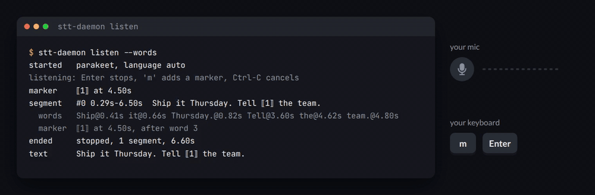
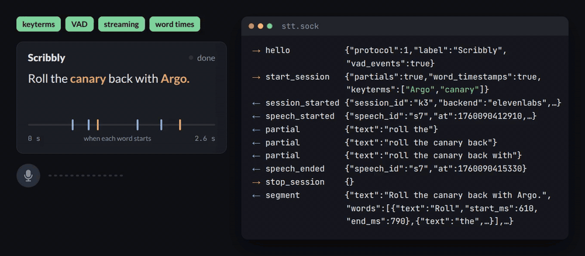
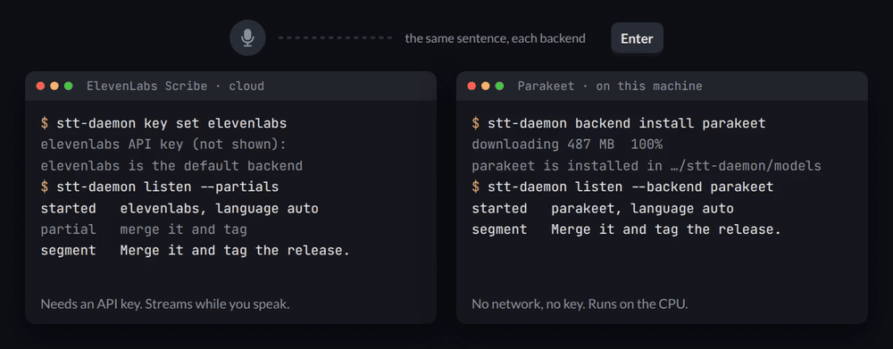

# stt-daemon

Your mic, as a service.

stt-daemon is a small local service that owns the microphone and turns speech
into text for any app on your machine. Apps connect over a Unix socket, get the
text as you speak, and never touch the mic themselves.

It handles what goes wrong in homemade voice input: cut-off first words,
pauses sent as audio, connections that drop mid-sentence. No recording code,
no audio files, no model or API to manage.

Transcribe in the cloud with ElevenLabs Scribe, or on your own CPU with
NVIDIA's Parakeet.



## Build your own client

The protocol is a few JSON lines over a socket, so a client gets written in
minutes, in any language. Say hello, start a session, read what comes back:

- **Streaming.** Partial text while you speak; final segments as they commit.
- **Word times.** Every word with its start and end, on the capture clock,
  pauses included.
- **Voice activity.** `speech_started` and `speech_ended` events. A client can
  start a session from a detected speech, and the first word is in it.
- **Key terms.** Names and jargon the backend should expect.
- **Markers.** Drop a marker at a moment and get it back between the words said then.
- **Context.** The previous text per window or document, so a dictation picks up
  where it left off.
- **Dictation first.** A dictation never waits for a file or meeting transcription on
  a full backend: the other session pauses, loses nothing, and goes on after.



Everything is in [docs/protocol.md](docs/protocol.md). Point your agent at it
and you're good to go.

## How it works

The daemon runs as a user service and holds the mic, with recent audio in a
buffer, so nothing gets chopped off the start of what you say. You can turn
that off and have the mic open only when transcribing. Apps connect over a Unix
socket and ask for a session; one dictation runs at a time. Two backends:

- **ElevenLabs Scribe v2 Realtime**, in the cloud. Needs an API key.
- **Parakeet TDT 0.6B v3**, local. Runs on the CPU.

Files also go to **ElevenLabs Scribe v2** as one upload (`elevenlabs-batch`, same key), which can
tell speakers apart.

Any other backend is a plugin you can [write yourself](#write-your-own-backend).



## Install

Copy and run it in your terminal:

```sh
uv tool install git+https://github.com/AndreiD108/stt-daemon && stt-daemon service install
```

The service starts at login.

## Set up a backend

```sh
stt-daemon key set elevenlabs          # cloud: asks for your API key
stt-daemon backend install parakeet    # local: downloads the model, 487 MB
```

One is enough. The first one you set up becomes the default;
`stt-daemon backend set-default parakeet` changes it, and
`stt-daemon backend remove parakeet` deletes the model again. `stt-daemon backend list` shows
each backend, whether it is ready, and the default. Keys live in
`~/.config/stt-daemon/credentials.toml`, readable by you only. Then:

```sh
stt-daemon listen --words
```

Speak, press Enter, and read what the daemon heard.

## Transcribe a file

```sh
stt-daemon transcribe talk.m4a notes.mp3           # the text of each, a blank line between
stt-daemon transcribe --json --backend parakeet talk.m4a   # text, words and segments as JSON
stt-daemon transcribe --diarize --speakers 2 interview.mp3   # each line starts with its speaker
```

With `elevenlabs` as the default, files go to `elevenlabs-batch`: the daemon uploads the file as
it is and prints the text when ElevenLabs answers. On Parakeet, the file goes through the daemon
as fast as the model takes it, and `ffmpeg` must be on your PATH; anything ffmpeg reads works,
audio or video. Either way, word times count from the start of the file.

## Transcribe a meeting

A client can transcribe what your machine plays, a call or a video, with
`start_system_session`. With `with_mic`, your mic is a second track, so both sides of a call come
out as one transcript, each line marked `[system]` or `[mic]`. It runs next to your dictation and
takes no mic slot. The mic track has echo cancellation, so speakers are fine.

- **Linux**: it needs `pw-record`, `pw-dump` and `pw-cli`, from your distribution's PipeWire
  tools, and PipeWire's echo-cancel module for the mic track; `stt-daemon service install` names
  the packages that are missing.
- **macOS** (14.2 or later): it needs [`audiotee`](https://github.com/makeusabrew/audiotee) on
  your `PATH` when you run `stt-daemon service install` (the agent keeps that `PATH`); build it
  with `swift build -c release`. If you install it later, run `stt-daemon service install`
  again. The first session makes macOS ask for the System Audio Recording permission for
  `stt-daemon`; allow it once.

To take one application's audio only, say the call app and not the music next to it, a client
picks it from the sources the daemon lists (every app that plays audio, with its name) and starts
the session with that app's id. When the app stops playing and starts again, the session picks
it up again on its own.

## Write your own backend

A backend plugin is one Python file in `~/.config/stt-daemon/backends/`. It implements one call,
`transcribe`: 16 kHz audio in, text out, with or without word times. The daemon does the rest:
dictation, files and meetings, markers, estimated word times, keys and the default. Clients pick
it by its name, and `stt-daemon backend list` shows whether it loaded. The contract and a complete
example for any OpenAI-compatible endpoint are in [docs/plugins.md](docs/plugins.md).

## Update

```sh
uv tool upgrade stt-daemon
stt-daemon service install
```

## Remove

```sh
stt-daemon service remove
uv tool uninstall stt-daemon
```

This keeps your settings, keys, and downloaded models in
`~/.config/stt-daemon` and `~/.local/share/stt-daemon`; delete those too if
you want them gone.

## License

MIT.
